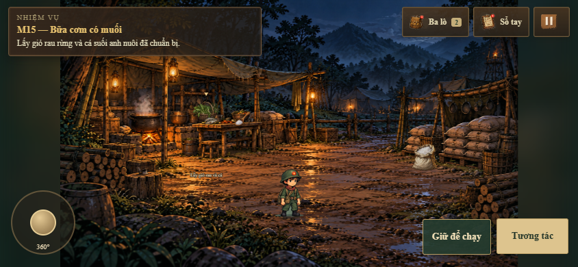

# Hạt Muối Trường Kỳ

Game web phiêu lưu giải đố lấy bối cảnh hành trình đưa muối Văn Lý lên Việt Bắc. Người chơi vào vai Kiên, đồng hành cùng đoàn công tác của đồng chí Nguyễn Lương Bằng qua **5 chương, 15 màn**.

Dự án dùng HTML, CSS, JavaScript và Canvas 2D; chạy trực tiếp trên trình duyệt, không cần npm hay bước build. Nội dung chuyển thể từ [GDD.md](GDD.md).



## Chạy game

Cần Python 3 để mở máy chủ tĩnh và trình duyệt hiện đại có hỗ trợ Canvas, Pointer Events và localStorage.

```sh
git clone https://github.com/TamPhamNang/TTHCM_BAN_CO_10_NAM_TUOI.git
cd TTHCM_BAN_CO_10_NAM_TUOI
python -m http.server 8000
```

Mở **http://localhost:8000** và chờ tải xong hình ảnh. Dùng máy chủ HTTP thay vì mở `index.html` bằng `file://` để ảnh Canvas và lưu tiến trình hoạt động đúng.

Để thử trên điện thoại thật, kết nối cùng mạng Wi-Fi với máy chạy server rồi mở `http://<IP-máy-chủ>:8000` trên điện thoại; máy chủ cần cho phép kết nối cổng 8000.

## Chơi trên điện thoại và máy tính bảng

**Bắt buộc xoay ngang thiết bị để chơi.** Ở chiều dọc, thông báo xoay ngang che màn hình và chặn thao tác; đồng hồ, hoạt ảnh và chuyển màn đều dừng. Thông báo xuất hiện ngay khi trang đang tải. Xoay ngang để tiếp tục đúng trạng thái.

Khung mobile trong chế độ responsive của trình duyệt cũng được nhận diện, kể cả khi chưa bật giả lập cảm ứng. Thay đổi kích thước hoặc xoay khung sẽ cập nhật giao diện ngay.

- **Bên trái:** cần di chuyển 360°; riêng màn đẩy bao dùng các nút hướng.
- **Bên phải:** nút thao tác riêng thay đổi theo màn: Tương tác, Ngồi thấp, Đẩy xe, Chèn đá, Đổi nhóm, La bàn, Đón/Chuyền bao…
- **Giữ để chạy:** dùng đồng thời với cần di chuyển bằng hai ngón.
- **Phía trên:** Ba lô, Sổ tay và Tạm dừng.
- Chạm trực tiếp để chọn vật phẩm, chia bao, lắp sạp; kéo bạt hoặc vẽ đường thuyền theo yêu cầu của màn.

Khi xoay máy, thao tác kéo và trạng thái giữ nút được hủy để tránh kẹt điều khiển. [Chi tiết giao diện và tỉ lệ nhân vật](docs/mobile-and-actor-layout.md).

## Nội dung 5 chương

| Chương | Màn | Nội dung |
| --- | --- | --- |
| **1 · Mật lệnh mùa đông** | 1–4 | Nhận la bàn và sổ tay từ Bác; chuẩn bị hành trang, giấu vàng trên tàu, giúp diêm dân và đẩy bao muối xuống thuyền. |
| **2 · Ngược dòng mùa mưa bão** | 5–7 | Dụ chó canh, mở dây chắn, che và buộc hàng trong bão, vẽ đường thuyền rồi ngụy trang trong bãi lau. |
| **3 · Xuyên rừng mùa thu** | 8–11 | Chia tải cho đoàn, đẩy xe theo nhịp, nấu nước lá chăm sóc bác Hai và đưa các nhóm vào núp khi máy bay tới. |
| **4 · Nước rút trên chiến khu** | 12–14 | Khảo sát hang, phát quang lối vào, dựng sạp chống ẩm và chuyền 100 bao muối vào kho trước bình minh. |
| **5 · Chung cuộc — Đêm lịch sử** | 15 | Chuẩn bị rau và cá, lấy muỗng, xúc muối Văn Lý, nấu canh, mời bộ đội dùng bữa và nhận huy hiệu Dũng sĩ Hậu cần. |

Menu có nút vào trực tiếp Chương 2–5 để chơi thử. **Bắt đầu / Chơi lại Chương 1** đặt lại bản lưu của hành trình hiện tại.

Hoàn thành màn sẽ tự chuyển cảnh. Cuối Chương 1–4, cuộn tới cuối nhật ký và chờ 2,5 giây để sang chương tiếp; cuộn lên để dừng đếm chờ. Nhật ký Chương 5 kết thúc hành trình. Mục **Nhật ký hành trình** trong menu cho phép đọc lại các chương đã hoàn thành.

Các thời lượng và số bao đại diện phục vụ gameplay. Hội thoại được rút gọn từ kịch bản; bản hiện tại chưa có phim hoặc giọng đọc thu sẵn.

## Điều khiển trên máy tính

| Thao tác | Điều khiển |
| --- | --- |
| Di chuyển | WASD / phím mũi tên; nhấp nền để tự tìm đường; cần analog tay cầm ở các màn đi lại. |
| Chạy | Giữ Shift. |
| Tương tác / tiếp hội thoại | E / Space hoặc nhấp người, đồ vật. |
| Ba lô / sổ tay | I / H. |
| Tạm dừng / đóng sổ | Esc. |
| M4 — Đẩy bao | WASD / mũi tên hoặc nhấp ô kề; C ngồi thấp, Z lùi bước, R xếp lại. |
| M5 — Trạm gác | C đi thấp / đứng lên; E tương tác. |
| M6 — Bão | Chọn hoặc kéo bạt vào khoang; nhấp khoang đã che để buộc dây. |
| M7 — Bãi lau | Giữ và kéo từ thuyền theo chấm dẫn đường; cập bãi rồi lấy bùn, lá để ngụy trang. |
| M9 — Đèo | E / Space đẩy theo nhịp; C hoặc nhấp đá gần xe để chèn khi trượt. |
| M11 — Máy bay | E thổi còi / đi tiếp; Q hoặc nhấp để chọn nhóm; C hoặc nhấp gốc cây để vào núp. |
| M12 — Hang | Q mở la bàn; E phát quang khi đã khảo sát đủ. |
| M14 — Chuyền muối | E / Space lần lượt đón và chuyền; chờ lượt hàng tới sạp. |

Nhân vật tự đi vòng vật cản khi chọn điểm đến. Ở M15, bếp, bàn, kho muối, thùng và chồng củi có vùng va chạm; điểm đứng tương tác nằm trước đồ vật.

## Lưu tiến trình

Game tự lưu bằng **localStorage** sau tương tác và định kỳ trong lúc chơi. Nút **Tiếp tục** khôi phục màn, vị trí, vật phẩm và giai đoạn nhiệm vụ, kể cả lúc nấu canh hoặc chuyền hàng.

Thời gian nhiệm vụ dừng trong hội thoại, khi mở ba lô/sổ tay, tạm dừng, mất focus hoặc giữ thiết bị mobile ở chiều dọc. Đọc lại nhật ký từ kho không sửa tiến trình đang lưu.

Bản lưu gắn với trình duyệt và địa chỉ truy cập. `localhost`, địa chỉ IP LAN hoặc một tên miền khác có vùng lưu riêng. Nếu trình duyệt chặn lưu trữ, game hiển thị trạng thái không lưu được; bản lưu prototype cũ giữ ở khóa riêng.

## Đồ họa và cấu trúc mã nguồn

Tỉ lệ nhân vật được căn theo phối cảnh từng màn, gồm cả đi lại, tư thế hành động, nhân vật phụ và hàng chuyền muối. Các phép phóng giữ điểm neo bàn chân. M15 dùng muỗng nhỏ neo theo tay; giỏ và muỗng đặt trên bàn bếp, bao muối cạnh kho. Hình nguồn được giữ trong `assets/`; các ảnh cần tách/cắt được xử lý khi tải.

Giao diện và chữ Canvas dùng **Times New Roman**, có Times/serif dự phòng. Các giấy tờ và nền sổ trong `assets/ui/` dùng chữ động hoặc vector để tránh chữ mẫu trên bảng ảnh nguồn.

| Đường dẫn | Vai trò |
| --- | --- |
| `index.html`, `css/` | Khung game, HUD, hội thoại, nhật ký và giao diện responsive. |
| `js/levels/chapter1.js` … `chapter5.js` | Cốt truyện, vật phẩm, cấu hình màn, vị trí và vùng va chạm. |
| `js/chapter-game.js` | Điều phối chương/màn, tương tác, tìm đường, lưu và khôi phục. |
| `js/chapter-assets.js`, `js/chapter-atlas.js`, `js/animation.js` | Nạp ảnh, atlas, sprite và hoạt ảnh. |
| `js/actor-layout.js` | Tỉ lệ nhân vật theo màn và cảnh mở đầu. |
| `js/mobile-controls.js`, `css/mobile.css` | Nhận diện mobile/khung giả lập, khóa chiều dọc và nút cảm ứng. |
| `js/river-*`, `js/forest-*`, `js/cave-*`, `js/supper-*` | Trạng thái gameplay và bộ vẽ Chương 2–5. |
| `js/chapter-diaries*.js` | Nội dung, mở khóa và đọc lại nhật ký. |
| `assets/` | Hình ảnh và tài sản giao diện. |
| `docs/`, `tests/` | Ghi chú triển khai, ảnh xem trước và kiểm thử. |

`js/game.js` và [Architecture v0.1.md](Architecture%20v0.1.md) là prototype/tài liệu trước đây, giữ để tham khảo. Runtime hiện tại khởi động từ `js/main.js` và `ChapterGame`.

## Kiểm thử

Các bài kiểm thử trình duyệt cần **Python, Playwright và Google Chrome**. Một số tiện ích xuất ảnh dùng Pillow.

```sh
python -m pip install playwright pillow
```

Mở server ở một terminal, rồi chạy các bộ kiểm thử ở terminal khác:

```sh
python tests/chapter1_browser.py
python tests/chapter2_browser.py
python tests/chapter3_browser.py
python tests/chapter4_browser.py
python tests/chapter5_browser.py
python tests/chapter5_layout.py
python tests/mobile_controls.py
```

Các bộ chơi xuyên chương kiểm tra tương tác, điều kiện nhiệm vụ, lưu/tải, tạm dừng, chuyển chương và lỗi JavaScript/HTTP. Bộ M15 kiểm tra vật cản, đường tiếp cận và khôi phục bản lưu cũ. Bộ mobile kiểm tra:

- Nút theo ngữ cảnh ở M1–M15; chạm chia đủ bao, đẩy xe và chuyền muối.
- Hai ngón đồng thời điều khiển cần và giữ chạy; hủy thao tác khi xoay máy.
- Khóa chiều dọc và dừng thời gian trên thiết bị cảm ứng **lẫn khung responsive không có touch**.
- Thông báo xuất hiện ngay cả khi JavaScript chưa chạy; chỉ mở chơi khi chuyển sang ngang.
- Bố cục điện thoại, máy tính bảng và cuộn nhật ký bằng thao tác chạm.

Mặc định kiểm thử dùng `http://127.0.0.1:8000/` và Chrome tại `C:/Program Files/Google/Chrome/Application/chrome.exe`. Đổi cấu hình qua `GAME_URL`, `CHROME_PATH`. Ví dụ PowerShell:

```powershell
$env:GAME_URL = 'http://127.0.0.1:8000/'
$env:CHROME_PATH = 'C:/Program Files/Google/Chrome/Application/chrome.exe'
python tests/mobile_controls.py
```

Các bộ `chapter*_dynamics.py`, `chapter1_animation.py`, `chapter1_layout.py`, `chapter4_asset_fixes.py`, `chapter_diaries_browser.py` và `stage_6_7_9_fixes.py` kiểm tra thêm nhịp mô phỏng, tư thế, dữ liệu lưu và các sửa lỗi trước đó.

Xuất ảnh rà soát nhân vật:

```sh
python tests/capture_actor_sizes.py
```

Kết quả kiểm tra gần nhất, **24/10/2026**: các bộ browser Chương 1–5, bố cục M15 và mobile đều đạt. Kiểm thử trên Chromium/Chrome với các khung thiết bị mô phỏng; ảnh rà soát có trong `docs/`.

## Tài liệu và ảnh xem trước

- [Kịch bản thiết kế](GDD.md).
- [Chương 1 — đồ họa](docs/chapter1-art.md), [Chương 2](docs/chapter2.md), [Chương 3](docs/chapter3.md), [Chương 4](docs/chapter4.md), [Chương 5](docs/chapter5.md).
- [Nhật ký hành trình](docs/chapter-diaries.md).
- [Mobile và tỉ lệ nhân vật](docs/mobile-and-actor-layout.md).
- [Ảnh đủ 15 màn](docs/characters-preview.jpg), [các tư thế hành động](docs/characters-actions.jpg).
- [Thông báo xoay ngang](docs/mobile-rotate.png), [đẩy xe trên mobile](docs/mobile-m9.png), [lán bếp M15](docs/mobile-m15.png).
